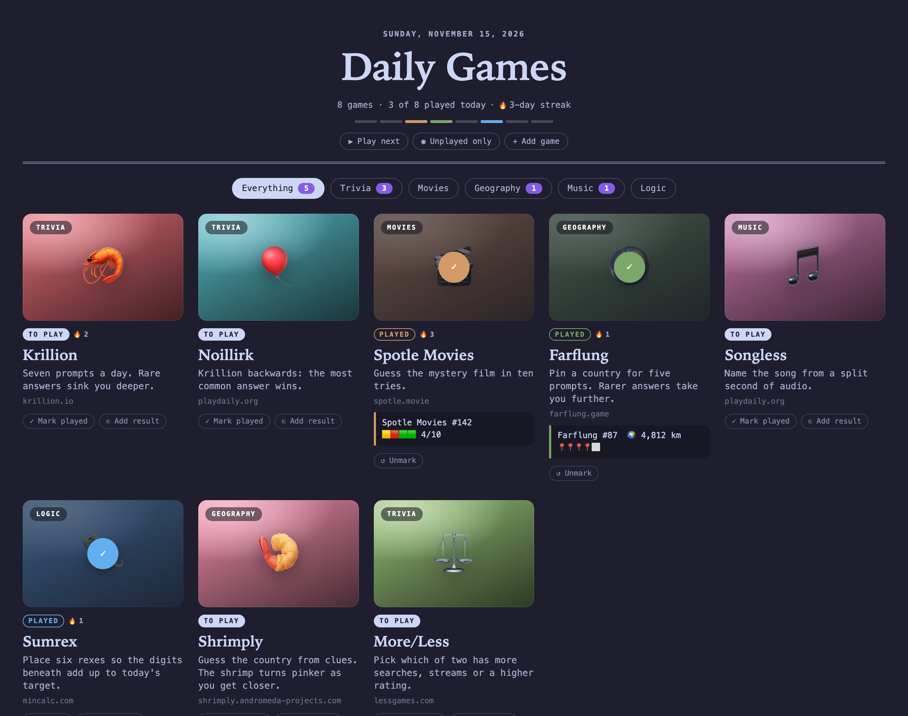

# Daily Games

A front page in Obsidian for the daily puzzle and trivia games you play: a grid of cards that shows what's left today, keeps streaks, and saves your results to your daily note.



## Features

- **A board for your games.** Each game is a card with a colour, an emoji or cover image, and a category. A header shows today's date, how many games you've played and your streak.
- **Played today.** Opening a game marks it played. Marks reset at midnight, or at a later hour if you play late. A progress bar fills in one coloured segment per game.
- **Streaks.** Each game counts the days in a row you've played it. The header counts the days in a row you've played anything.
- **Results.** Paste a game's share text (the 🟩🟨 grid). It shows on the card and is added to today's daily note under a heading of your choice.
- **Filters.** Filter by category, or show only games you haven't played. **Play next** opens the next unplayed game.
- **Opens inside Obsidian.** With the Web viewer core plugin on, games open in an Obsidian tab. Cmd/Ctrl-click opens them in your browser instead, and a setting swaps the two.
- **Follows your theme.** Colours, corners and fonts come from your theme, in light and dark mode.

## Usage

Open the board from the dice icon in the ribbon, or with the **Daily Games: Open board** command.

To put the board in a note, such as a homepage or a daily note template, add a `daily-games` code block:

````markdown
```daily-games
```
````

Options, one per line inside the block:

| Option | Effect |
| --- | --- |
| `compact: true` | A one-line header instead of the large masthead. |
| `category: Trivia` | Show only one category. |

Add, edit, reorder and remove games in **Settings → Daily Games**, or with **Add game** on the board.

### Results in your daily note

When you save the first result for a game today, it's added to today's daily note as a callout:

```markdown
## Daily games

> [!success] 🎬 Spotle Movies
> ```text
> Spotle Movies #142
> 🟨🟥🟩🟩 4/10
> ```
```

The result is written as plain text in a code block, so nothing pasted from a web page can turn into a link, an embed or a script in your note.

This needs the **Daily notes** core plugin. If today's note doesn't exist yet, it's created from your daily note template. You can turn this off or change the heading in settings.

## Settings

| Setting | Default |
| --- | --- |
| Title | Daily Games |
| Open games in | Obsidian web viewer (falls back to the browser when Web viewer is off) |
| Mark played when opened | On |
| New day starts at | Midnight |
| Add results to the daily note | On |
| Daily note heading | `## Daily games` |

## Privacy and security

- The plugin makes no network requests of its own. Game pages load only when you open them, in Obsidian's Web viewer or your browser.
- Cover images, if you set any, load from the `https://` links you give, without sending a referrer.
- Play history and results stay in the plugin's data file in your vault.
- Only `http://` and `https://` game links are accepted, so a link can't run code or open local files. Colours must be hex values.
- The data file is validated every time it loads, including when it changes through sync, so a corrupt or tampered file falls back to defaults instead of breaking the plugin.

## Installation

From Obsidian: **Settings → Community plugins → Browse**, search for "Daily Games", then install and enable it.

Manually: download `main.js`, `manifest.json` and `styles.css` from the [latest release](../../releases/latest) into `<your vault>/.obsidian/plugins/daily-games/`, then enable the plugin in **Settings → Community plugins**.

## Development

Uses [pnpm](https://pnpm.io) (version in `package.json`'s `packageManager`) and Node 22+.

```bash
pnpm install
pnpm dev           # rebuild on change
pnpm build         # type-check and production build
pnpm lint          # Obsidian's ESLint rules
pnpm test          # unit tests
pnpm install-plugin "/path/to/vault"   # copy the build into a vault
```

Dependency hardening lives in `pnpm-workspace.yaml`:
- Only versions published at least 7 days ago are installed.
- Git and tarball dependencies of dependencies are refused.
- Install scripts are blocked unless listed.
- Installs fail when a package's trust evidence gets weaker than in earlier versions.

Dependabot proposes updates weekly with the same 7-day cooldown.

### Releasing

```bash
npm version patch   # bumps package.json, manifest.json and versions.json, and tags
git push --follow-tags
```

The release workflow audits, lints, tests and builds the tag, then publishes `main.js`, `manifest.json` and `styles.css` with a signed [build provenance attestation](https://docs.github.com/actions/security-for-github-actions/using-artifact-attestations). To check a downloaded file was built from this repository:

```bash
gh attestation verify main.js --repo Grzelox/obsidian-daily-games
```

## License

[MIT](LICENSE)
